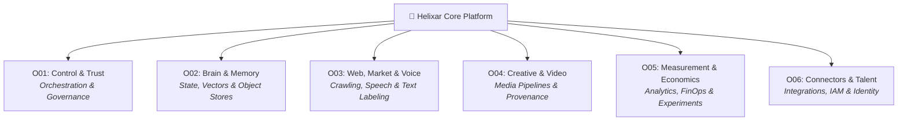

<div align="center">

# 🧬 Helixar OSS Labs
### Architecture Evaluation, Empirical Benchmarking & Source Governance Suite

[](https://github.com/vdnthtml/helixar-oss-lab)
[](https://github.com/vdnthtml/helixar-oss-lab)
[](https://python.org)
[](https://github.com/vdnthtml/helixar-oss-lab)

<p align="center">
  <strong>Helixar OSS Labs</strong> is a rigorous empirical research and evaluation laboratory designed to evaluate, test, and vet best-in-class open-source technologies across the 6 foundational pillars of the <strong>Helixar Platform</strong>.
</p>

</div>

---

## 📑 Table of Contents

- [Overview](#-overview)
- [Architecture & Lab Domains](#-architecture--lab-domains)
  - [O01: Control & Trust](#o01---control--trust)
  - [O02: Brain & Memory](#o02---brain--memory)
  - [O03: Web, Market & Voice](#o03---web-market--voice)
  - [O04: Creative & Video](#o04---creative--video)
  - [O05: Measurement & Economics](#o05---measurement--economics)
  - [O06: Connectors & Talent](#o06---connectors--talent)
- [Key Architectural Findings](#-key-architectural-findings)
- [Repository Structure](#-repository-structure)
- [Getting Started & Usage](#-getting-started--usage)
  - [Prerequisites](#prerequisites)
  - [Running a Lab Module](#running-a-lab-module)
  - [Validating Deliverables](#validating-deliverables)
- [Audit & Governance Protocol](#-audit--governance-protocol)
- [License & Provenance](#-license--provenance)

---

## 🔭 Overview

Modern enterprise AI platforms require robust guarantees around **durable execution, stateful memory, content governance, cost economics, and third-party risk**. 

Rather than adopting libraries blindly, **Helixar OSS Labs** subjects every candidate tool to an empirical audit ladder:
1. **Source Inspection & License Proof:** Cryptographic SHA-256 verification of license files, source trees, and repository commits.
2. **Security & Egress Profiling:** Identifying default telemetry, unsecured ports, root credentials, and undocumented network calls.
3. **Bounded Fixture Execution:** Evaluating runtime behavior, memory consumption, latency, and failure semantics under reproducible conditions.
4. **Receipt Generation:** Emitting immutable cryptographic receipts (`receipt-data.json`, `validation-result.json`, `process-log.jsonl`) verifying that every evaluation command ran under bounded, verifiable conditions.

---

## 🏛 Architecture & Lab Domains



### O01 - Control & Trust
*Focus: Durable workflows, state machines, policy engines, and AI safety evaluation.*
- **Core Candidates:** [Temporal](https://github.com/temporalio/temporal), [LangGraph](https://github.com/langchain-ai/langgraph), [OpenPolicyAgent (OPA)](https://github.com/open-policy-agent/opa), [Cedar Policy](https://github.com/cedar-policy/cedar), [OpenFGA](https://github.com/openfga/openfga), [Presidio](https://github.com/data-privacy-stack/presidio), [Promptfoo](https://github.com/promptfoo/promptfoo), [Giskard](https://github.com/Giskard-AI/giskard-oss), [Garak](https://github.com/NVIDIA/garak), [Inspect AI](https://github.com/UKGovernmentBEIS/inspect_ai), [PyRIT](https://github.com/microsoft/PyRIT).
- **Deliverables:** Authorization policy benchmark (`poc-opa-vs-cedar`), prompt injection defenses, execution telemetry wrappers (`OpenTelemetry`, `OpenInference`, `Langfuse`).

### O02 - Brain & Memory
*Focus: Long-term conversational memory, vector persistence, and content-addressed storage.*
- **Core Candidates:** [PostgreSQL + pgvector](https://github.com/pgvector/pgvector), [Qdrant](https://github.com/qdrant/qdrant), [MinIO](https://github.com/minio/minio), [Letta (MemGPT)](https://github.com/letta-ai/letta), [Mem0](https://github.com/mem0ai/mem0), [Graphiti](https://github.com/getzep/graphiti), [LlamaIndex](https://github.com/run-llama/llama_index), [Unstructured](https://github.com/Unstructured-IO/unstructured).
- **Deliverables:** Storage architecture recommendation (`storage-candidate-recommendation.md`), schema fixture specs, and multi-tenant partitioning strategies.

### O03 - Web, Market & Voice
*Focus: Headless crawling, market intelligence, audio transcription, and semantic topic modeling.*
- **Core Candidates:** [Crawlee](https://github.com/apify/crawlee-python), [ChangeDetection](https://github.com/dgtlmoon/changedetection.io), [Readability](https://github.com/mozilla/readability), [OpenAI Whisper](https://github.com/openai/whisper), [BERTopic](https://github.com/MaartenGr/BERTopic), [Argilla](https://github.com/argilla-io/argilla), [Formbricks](https://github.com/formbricks/formbricks), [Taguette](https://github.com/taguette/taguette), [Lighthouse / Unlighthouse](https://github.com/GoogleChrome/lighthouse).
- **Deliverables:** Reproducible web corpus extraction runners, transcription benchmarks, and data enrichment fixtures.

### O04 - Creative & Video
*Focus: Video processing, media timeline orchestration, multimodal metrics, and provenance standards.*
- **Core Candidates:** [FFmpeg](https://github.com/FFmpeg/FFmpeg), [OpenTimelineIO](https://github.com/AcademySoftwareFoundation/OpenTimelineIO), [VBench](https://github.com/Vchitect/VBench), [VideoScore](https://github.com/TencentARC/VideoScore), [C2PA (Coalition for Content Provenance and Authenticity)](https://github.com/c2pa-org/c2pa-rs), TwelveLabs SDK, Hume AI SDK.
- **Deliverables:** Video evaluation reconciliations, cross-packet evidence summaries, and cryptographic media provenance validation.

### O05 - Measurement & Economics
*Focus: Analytics engines, marketing mix modeling (MMM), metric computation, and cost telemetry.*
- **Core Candidates:** [DuckDB](https://github.com/duckdb/duckdb), [Cube.js](https://github.com/cube-js/cube), [Robyn](https://github.com/facebookexperimental/Robyn), [Google Meridian](https://github.com/google/meridian), [GrowthBook](https://github.com/growthbook/growthbook), [Unleash](https://github.com/Unleash/unleash), [Flagd (OpenFeature)](https://github.com/open-feature/flagd), [OpenCost](https://github.com/opencost/opencost), [OpenLineage](https://github.com/OpenLineage/OpenLineage).
- **Deliverables:** License analysis, PyPI manifest fingerprints, and unified metric calculation testbeds.

### O06 - Connectors & Talent
*Focus: Enterprise integrations, workflow triggers, consent management, deduplication, and CRM/ATS.*
- **Core Candidates:** [Activepieces](https://github.com/activepieces/activepieces), [Nango](https://github.com/NangoHQ/nango), [Twenty CRM](https://github.com/twentyhq/twenty), [Frappe HR](https://github.com/frappe/hrms), [OpenCATS](https://github.com/opencats/opencats), [Klaro Consent](https://github.com/klaro-org/klaro), [Dedupe](https://github.com/dedupeio/dedupe).
- **Deliverables:** Environment compatibility testbeds, schema migrations, and enterprise connector evaluation suites.

---

## 💡 Key Architectural Findings

| Architectural Domain | Recommended Winner | Disposition / Rationale |
|---|---|---|
| **Vector & Operational DB** | **PostgreSQL + pgvector** | **ADAPT:** Co-locates relational ACID transactions, tenant boundaries, governance metadata, and vector embeddings in one proven engine. Start with exact search; introduce HNSW partitions as corpus scales. |
| **Object / Blob Storage** | **S3-Compatible Protocol Port** | **REJECT MinIO for Ops:** MinIO community repo is unmaintained, source-only AGPL-3.0, and lacks native content-addressing. Use standard S3-compatible provider abstraction with SHA-256 application hashing. |
| **Dedicated Vector Engines** | **Qdrant** | **POC_MORE / Scale-Triggered:** Excellent dedicated vector features, but default configs expose telemetry, CORS, and unauthenticated endpoints. Keep behind reserve until latency/scale demands it. |
| **Fine-Grained Authorization** | **OPA & Cedar** | **ADAPT:** Decoupled policy evaluation with strict JSON schema inputs. Evaluated for deterministic response times and auditability. |

---

## 📂 Repository Structure

```text
helixar-oss-labs/
├── .gitignore                      # Configured to ignore ephemeral envs & large binaries
├── README.md                       # Master architecture and onboarding manual
│
├── O01-control-trust/              # Control, durable workflows, OPA/Cedar policy & safety
│   ├── fetch_sources.py            # Automated deterministic repository cloner
│   ├── labrun.py                   # Bounded command runner with audit telemetry
│   ├── generate_deliverables.py     # Aggregator for lab artifacts
│   ├── validate_deliverables.py     # Cryptographic integrity checker
│   ├── lab-summary.json            # Consolidated candidate findings and stats
│   ├── receipt-data.json           # Execution hash and audit receipt
│   ├── inspected/                  # Harvested READMEs, manifests, and licenses
│   └── poc-opa-vs-cedar/           # Policy comparison proof-of-concept
│
├── O02-brain-memory/               # Vector search, memory engines, storage analysis
│   ├── storage-candidate-recommendation.md # In-depth storage architectural review
│   ├── candidate-source-manifest.json      # Commit & tree SHA registry
│   ├── storage-fixture-spec.json   # Testbed definitions for pgvector/Qdrant
│   ├── final_validate.py           # Verification harness
│   └── artifacts/                  # Generated benchmark data
│
├── O03-web-market-voice/           # Crawling, transcription (Whisper), topic modeling
│   ├── O03_finalise.py             # Final lab summarizer
│   ├── source-metadata.json        # Upstream source metadata
│   └── final-summary.json          # Metric outputs and runtime statistics
│
├── O04-creative-video/             # Media pipelines, video scoring, C2PA provenance
│   ├── cross-packet-reconciliation.json    # Upstream version alignments
│   ├── external-evidence-summary.json     # Multimodal framework capabilities
│   └── repo-metadata.json          # Video repo specifications
│
├── O05-measurement-economics/      # DuckDB analytics, MMM (Robyn/Meridian), flags
│   ├── extract_license.py          # Automated license compliance extractor
│   ├── extract_source_docs.py      # Documentation extractor
│   └── artifacts/                  # Package metadata and manifest caches
│
└── O06-connectors-talent/          # Connectors (Activepieces, Nango), CRM & IAM
    ├── run_logged.py               # Monitored execution harness
    └── artifacts/                  # Extracted connector manifests
```

---

## 🚀 Getting Started & Usage

### Prerequisites
- Python 3.10 or higher
- Git 2.30+
- macOS (arm64/x86_64) or Linux

### Running a Lab Module
Each lab module contains self-contained runner and source retrieval scripts. For example, to inspect candidates in `O01-control-trust`:

1. **Navigate to the target lab:**
   ```bash
   cd O01-control-trust
   ```

2. **Fetch and pin upstream sources:**
   The `fetch_sources.py` script shallow-clones the exact candidate repositories, extracts licenses, manifests, and commit hashes:
   ```bash
   python3 fetch_sources.py
   ```

3. **Execute bounded fixtures / inspections:**
   Run the evaluation script via the monitored runner:
   ```bash
   python3 generate_deliverables.py
   ```

### Validating Deliverables
Every lab includes a cryptographic verification script that verifies output hashes against the recorded receipts:

```bash
cd O01-control-trust
python3 validate_deliverables.py
```
This inspects `validation-result.json` and ensures that no source files, manifests, or fixtures were mutated out-of-band.

---

## 🔒 Audit & Governance Protocol

All evaluations conducted in this repository adhere to the **Helixar Lab Governance Standard**:
1. **Network Bounds:** All external calls are logged to `network-log.jsonl` or `process-log.jsonl`. Unplanned network requests immediately trip a validation failure.
2. **Immutability:** Source code trees are pinned to specific git commit hashes and tree SHA-256 digests.
3. **Receipt Trail:** Upon completion, `receipt-data.json` records total command counts, network counts, and file digests.

---

## ⚖️ License & Provenance

The evaluation scripts, harnesses, architectural documentation, and synthesis reports in this repository are licensed under the **Apache License, Version 2.0**.

*All third-party open-source projects referenced and evaluated remain subject to their respective upstream licenses (MIT, Apache-2.0, BSD-3-Clause, AGPL-3.0, etc.). See the respective `source-metadata.json` and `inspected/` directories for complete upstream copyright and license notices.*
